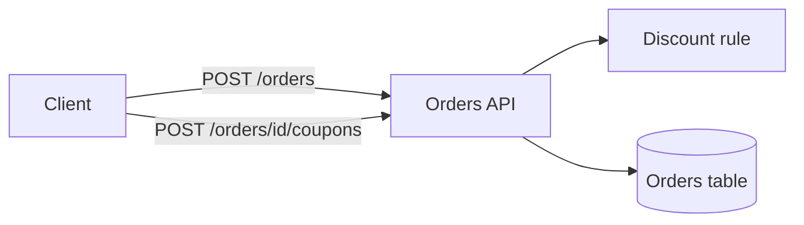
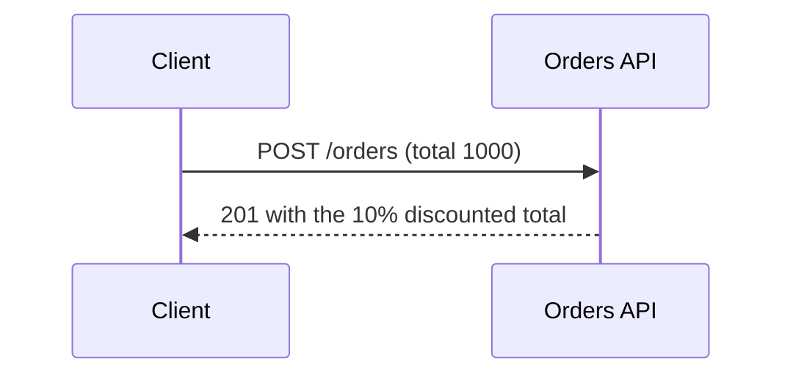

# Design: FEAT-007 Order discounts

## Components and data flow

## Key interaction

## Decisions the diagrams show

- The discount rule is a pure function of the order total, so it needs no seam.
