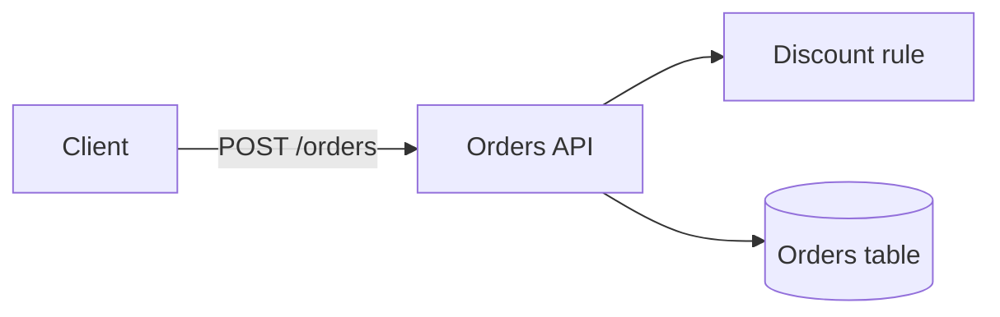
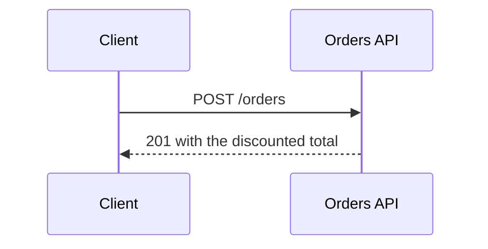
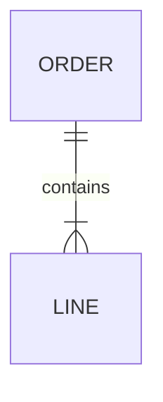

# Design: FEAT-000 <title>

<!-- Written by the system-analyst in the system-map phase, from the approved scenarios, the approved product design and
     the code it read. Two parts: the Mermaid views, then the technical design, fourteen sections that are each one
     table. `bdd design FEAT-n` checks both and prints the design's digest, which the design reviews name.

     Views: only the ones this feature needs, each small enough to review in a minute. Plain Mermaid, nothing active
     (no click, href or init directives). `%% interface: NAME` comments say which rows of the Interfaces table in
     system.md a diagram shows.

     Sections: keep every heading and table header. A section that does not apply holds one row: `n/a` in the first
     cell and the reason in the next. Use `-` for a cell that does not apply to a row. -->

## Components and data flow

## Key interaction

## Data model

<!-- For a feature that changes the schema: the tables it adds or changes, with keys and the cardinality of each
     relation, so the person sees them before binding (card `database-schema`). -->

## Design trace

<!-- Every element of every screen row of the approved design that names this feature (`bdd design FEAT-n --screens`
     lists them, with their fields), and every field the API carries: the rule it serves, the API field and the
     component. Screen is the inventory id, or `-` for a field with no screen. -->

| Screen | Element | Rule | API field | Component |
|---|---|---|---|---|
| S-OR-01 Order form | total | R-000.1 | order.total | MoneyText |

## Building blocks

<!-- One row per field with an API field: its kind, the standard, the library or platform API, the package
     (`npm:NAME`, `pypi:NAME`, ... or `-` for a platform API) and the documentation read (an https address or a file of
     the installed package). Card `standard-values`. -->

| Field | Kind | Standard | Library | Package | Source |
|---|---|---|---|---|---|
| total | money | ISO 4217, integer minor units | Intl.NumberFormat | - | https://developer.mozilla.org/en-US/docs/Web/JavaScript/Reference/Global_Objects/Intl/NumberFormat |

## External services

<!-- Every SDK or API call to a system outside the project. The orchestrator records its evidence with
     `bdd docs FEAT-n --service NAME --source URL` (or `--mcp SERVER --query TEXT`, or `--cli COMMAND`), from what
     `.bdd/sources.toml` names for the service. -->

| Service | Call | Quota | Cost | On failure |
|---|---|---|---|---|
| n/a | the feature calls no outside service | | | |

## Architecture

<!-- Where each new piece lives, in the layers of `.bdd/architecture.md`. -->

| Piece | Layer | Path |
|---|---|---|
| discount rule | service | src/orders/discount.ts |

## Patterns

<!-- The project's own patterns to copy, each with a file that shows it. -->

| Pattern | Example file | Use for |
|---|---|---|
| service with a repository | src/orders/service.ts | the discount rule |

## API contract

<!-- The schema fragment of each endpoint, its version, and what older clients still get. -->

| Endpoint | Request | Response | Version | Older clients |
|---|---|---|---|---|
| POST /orders | lines, currency | 201 with total and discount | v1 | unchanged: discount is a new optional field |

## Data and performance

<!-- Kind is table, migration, query, operation, cache, volume or job. A query names its index, an operation (every
     endpoint is one) its budget, a migration its rollback (cards `database-schema`, `database-performance`). -->

| Kind | Name | Detail | Index | Budget | Rollback |
|---|---|---|---|---|---|
| query | orders of a customer | where customer_id = ? order by created_at | orders_customer_created_idx | - | - |
| operation | POST /orders | one insert and its lines | - | p95 under 300 ms | - |

## Security and privacy

<!-- Kind is authorisation, validation, secret, personal data, rate limit or threat. Every endpoint has an
     authorisation row: who may do what, on which records, checked where on the server. Personal data says how long
     it is kept (card `security`). -->

| Kind | Subject | Decision | Enforced in |
|---|---|---|---|
| authorisation | POST /orders | a signed-in customer, for their own orders | the service, from the session |
| rate limit | POST /orders | 10 a minute per customer | the API gateway |

## Errors and resilience

<!-- Every failure the feature can meet (network, timeout, conflict, a request sent twice, partial failure), what the
     person sees, and the retry and idempotency that make it safe. -->

| Failure | The user sees | Retry and idempotency |
|---|---|---|
| the order is sent twice | one order | an idempotency key per checkout |

## State and offline

<!-- Per screen: every state of its inventory row, where client state is kept, what happens offline and on reconnect;
     background jobs and notifications. -->

| Screen | States | Kept where | Offline and reconnect |
|---|---|---|---|
| S-OR-01 | loading, error, success | the form, on the client | Place order waits until the network is back |

## Accessibility and language

<!-- Per screen: labels and focus, contrast and text size, the strings to translate and the locale formats of dates,
     numbers, money and addresses (card `accessibility`). -->

| Screen | Labels and focus | Contrast and text size | Strings and locale |
|---|---|---|---|
| S-OR-01 | every input labelled; errors tied to the field | the tokens; text at 200% | strings in the catalogue; money in the person's locale |

## Observability

<!-- The logs, metrics and traces that show the feature works in production, with no personal data in them. -->

| Signal | Kind | Shows |
|---|---|---|
| order.placed | metric | orders per minute, by currency |

## Configuration and delivery

<!-- New settings and secrets per environment, feature flags, and the order of migrations on deploy. -->

| Setting | Per environment | Deploy order |
|---|---|---|
| n/a | the feature adds no setting, secret or flag | |

## Test strategy

<!-- Which levels test what, beyond the scenarios: unit, contract, scenario, end to end, performance. -->

| Level | What it tests | Where |
|---|---|---|
| unit | the discount rule at its boundaries | src/orders/discount.test.ts |
| performance | POST /orders against its budget | tests/perf/orders.k6.js |

## Decisions the diagrams show

- <choice made, and why, in one line each>
