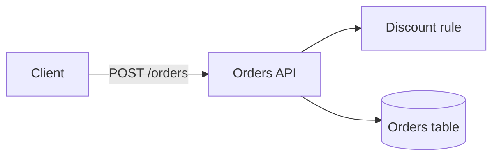
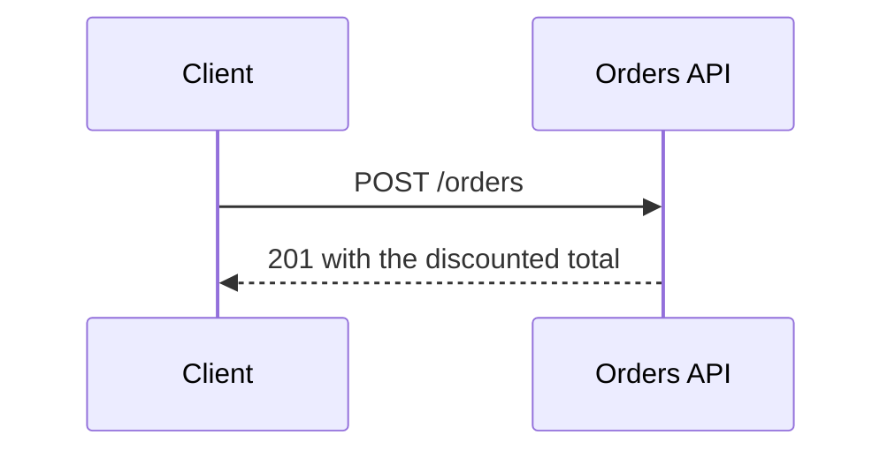
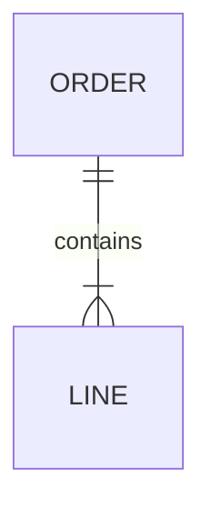

# Design: FEAT-000 <title>

<!-- Written by the system-analyst in the system-map phase, from the approved scenarios and the code it read.
     Only the views this feature needs, each small enough to review in a minute. Plain Mermaid, nothing active
     (no click, href or init directives). `%% interface: NAME` comments say which rows of the Interfaces table in
     system.md a diagram shows; `bdd design FEAT-n` checks that they exist. -->

## Components and data flow

## Key interaction

## Data model

<!-- For a feature that changes the schema: the tables it adds or changes, with keys and the cardinality of each
     relation, so the person sees them before binding (card `database-schema`). -->

## Decisions the diagrams show

- <choice made, and why, in one line each>
